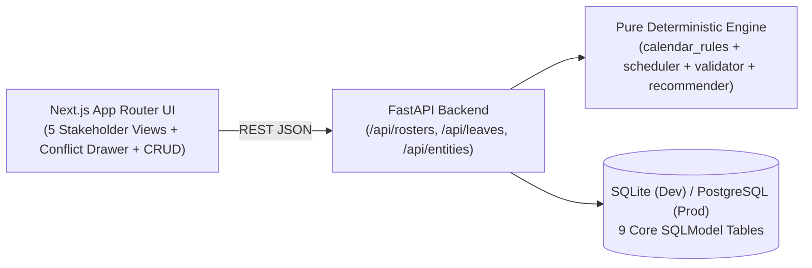

# Smart Roster Management System

> Built for the **Datastraw Tech Internship Assessment Test**.
>
> **Core Principle**: Reliable deterministic scheduling logic, explicit hard vs. soft conflict detection, and live post-generation change impact over unnecessary visual bloat.

---

## 1. Overview & Architecture

The **Smart Roster Management System** solves multi-client operational scheduling for D2C customer experience teams (**32 employees** across **4 pods**, **20 brands**, and **5 processes**: `CS`, `ACC`, `RET`, `NDR`, `Escalations`).



### Key Architectural Pillars
1. **Strict Separation of Demand vs. Supply Calendars**:
   - **Demand (`brand_process_rules`)**: Operating calendars (`365_DAYS`, `DAILY_EXCEPT_PH`, `MON_SAT_EXCEPT_PH`) + day-of-week `min_staffing` overrides (`0=Mon .. 6=Sun`).
   - **Supply (`employees`, `leaves_and_compoffs`, `public_holidays`)**: Individual shifts, fixed/rotational weekly offs, preferred off days, public holidays, planned leaves, and comp-offs.
2. **Pure Deterministic Scheduling Engine (`backend/engine/`)**:
   - Zero FastAPI/HTTP imports or random/LLM calls in the core engine — fast (< 50ms per monthly run), reproducible, and verified by 15 automated `pytest` tests.
3. **Hard vs. Soft Conflict Detection (6 Validation Passes)**:
   - **HARD**: `UNCOVERED_BRAND_PROCESS`, `INSUFFICIENT_STAFFING`, `MULTI_BRAND_CASCADE`, `LEAVE_OR_OFF_VIOLATION`, `SHIFT_OR_OVERLOAD_CONFLICT`.
   - **SOFT**: `PREFERENCE_VIOLATED` (when a rotational weekly off is shifted to protect mandatory client coverage).
4. **Live Change Impact Analysis**:
   - Manual cell overrides (`PATCH /api/rosters/{month}/entry`), post-generation leave approvals (`POST /api/leaves/{id}/approve`), and 1-click backup assignments (`POST /api/rosters/{month}/assign-backup`) immediately re-evaluate coverage and conflicts without wiping unrelated manual adjustments.

---

## 2. Tech Stack

- **Backend**: Python 3.11+, FastAPI, SQLModel (SQLAlchemy + Pydantic v2), Pytest
- **Database**: SQLite (`sqlite:///./roster.db` for local dev) / PostgreSQL on Supabase (`DATABASE_URL` in production)
- **Frontend**: Next.js (App Router), TypeScript (strict), Tailwind CSS, Lucide Icons
- **Deployment**: Vercel (Frontend), Render / Railway (Backend), Supabase (PostgreSQL)

---

## 3. Quickstart Guide

### Environment Variables
Copy `.env.example` to `.env` (backend) or `.env.local` (frontend) as needed:
- `DATABASE_URL`: Defaults to `sqlite:///./roster.db`. Set to your Supabase/PostgreSQL URI in production.
- `CORS_ORIGINS`: Comma-separated allowed frontend origins (e.g., `http://localhost:3000`).
- `NEXT_PUBLIC_API_URL`: Backend URL consumed by Next.js (defaults to `http://localhost:8000`).

### Backend Setup
```bash
cd backend
python -m venv .venv
# Windows:
.venv\Scripts\activate
# Unix/macOS:
source .venv/bin/activate

pip install -r requirements.txt
python seed.py
pytest -v
uvicorn main:app --reload --port 8000
```

### Frontend Setup
```bash
cd frontend
pnpm install   # or npm install
pnpm dev       # or npm run dev
```

---

## 4. Built-In Demo Scenarios (`2026-12`)

1. **`DEMO-1` (`BRD-02` VelvetDew Skincare)**: Single-resource `365_DAYS` CS brand flags hard coverage gaps on `EMP-06`'s Wednesday weekly offs and Dec 18 comp-off, with ranked backup suggestions.
2. **`DEMO-2` (`EMP-08` → `BRD-04` + `BRD-05`)**: `EMP-08`'s Dec 10–11 planned leave flags a grouped `MULTI_BRAND_CASCADE` conflict across 2 brands simultaneously.
3. **`DEMO-3` (`BRD-18` StrideCraft Footwear)**: When `EMP-16` is on leave Dec 14–15, Tue Dec 15 (`min_staffing=1`) stays **COVERED** by `EMP-17`, while peak Mon Dec 14 (`min_staffing=2`) auto-activates configured backup `EMP-18` (`BACKUP_COVERED`).
4. **`DEMO-4` (`LV-07` → `EMP-12` / `BRD-06`)**: Approving pending leave `LV-07` (Dec 16–17) *after* roster generation immediately flags the `BRD-06` gap and offers 1-click Pod-2 backup assignment inside the Conflict Drawer.

---

## 5. Tell Us How You Think (Section 8 Q&A)

### 1. How did you model employees, brands, processes, pods, and their relationships?
I modeled the domain using 9 normalized relational tables (`pods`, `processes`, `employees`, `brands`, `brand_process_rules`, `allocations`, `public_holidays`, `leaves_and_compoffs`, and `rosters`/`roster_entries`/`roster_conflicts`).
- **Pods** group **Employees** and **Brands** under a **Pod Lead**, enabling pod-level backup prioritization.
- **Processes** (`CS`, `ACC`, `RET`, `NDR`, `ESC`) are decoupled from **Brands** via `brand_process_rules`, so a single brand can have `CS` running `365_DAYS` while `ACC` runs `MON_SAT_EXCEPT_PH`.
- **Allocations** act as a many-to-many join table between `employees`, `brands`, and `processes` with an explicit `allocation_type` (`PRIMARY` vs `BACKUP`), cleanly supporting both single-resource owners and multi-resource shared queues.

### 2. How does your system generate a roster and determine whether it satisfies the required constraints?
Generation runs in four deterministic stages inside `backend/engine/scheduler.py`:
1. **Demand Resolution**: For each `(brand, process, date)`, `calendar_rules.py` resolves whether the process operates on that date (accounting for Sundays and public holidays) and looks up `required_staffing` including day-of-week overrides.
2. **Supply Resolution**: For each employee and date, the engine assigns base status (`PLANNED_LEAVE`, `COMP_OFF`, `PUBLIC_HOLIDAY` if none of their primary brands run `365_DAYS`, `WEEKLY_OFF` with rotational staggering, or `WORKING`).
3. **Coverage & Backup Matching**: Counts active `PRIMARY` employees per `(brand, process, date)` and auto-assigns configured `BACKUP` employees when a shortfall exists.
4. **6-Pass Validation (`validator.py`)**: Checks every slot and employee stretch for `UNCOVERED_BRAND_PROCESS`, `INSUFFICIENT_STAFFING`, `MULTI_BRAND_CASCADE`, `LEAVE_OR_OFF_VIOLATION`, `SHIFT_OR_OVERLOAD_CONFLICT`, and `PREFERENCE_VIOLATED`.

### 3. How did you handle the difference between single-resource brands and brands with multiple employees?
Both use the exact same `allocations` and `brand_process_rules` data model rather than special-cased branches. For **single-resource brands** (~80%), one employee holds `PRIMARY` allocations for all of the brand's processes; if that brand runs `365_DAYS` or `DAILY_EXCEPT_PH`, the employee's mandatory weekly off naturally surfaces a `HARD` gap requiring a backup/floater. For **multi-resource brands** (~20%), multiple employees either own distinct processes or share the same `(brand, process)` key — in which case the scheduler staggers `ROTATIONAL` weekly offs across peers so `working_count >= min_staffing` is preserved automatically.

### 4. What happens when an employee manages all processes for a brand but is unavailable on a required working day?
1. The employee's status on that date is set to `WEEKLY_OFF`, `PLANNED_LEAVE`, or `COMP_OFF`.
2. Every `(brand, process)` rule they own where `required_staffing > 0` drops to `working_count = 0` (`UNCOVERED`) unless a configured secondary `BACKUP` is available.
3. The validator emits `UNCOVERED_BRAND_PROCESS` (**HARD**) conflicts — and if that employee owns `>= 2` brands (like `EMP-08` on `BRD-04` and `BRD-05`), it also emits a grouped `MULTI_BRAND_CASCADE` (**HARD**) conflict.
4. `recommender.py` immediately scores and attaches the top 4 backup candidates (Same-Pod Floater: 100, Same-Pod Surplus Associate: 80, Cross-Pod Floater: 60, Pod Lead Escalation: 40) so the manager can resolve it in 1 click.

### 5. How does your system handle conflicting requirements or insufficient staffing?
It enforces a strict **Hard vs. Soft constraint hierarchy** and **never silently hides invalid states**:
- Hard client coverage (`required_staffing`) always overrides soft preferences (`preferred_weekly_off`), emitting a `SOFT` `PREFERENCE_VIOLATED` warning when an off day is shifted.
- When even after rotational staggering and configured backups `working_count < required_staffing`, the slot is explicitly marked `UNDERSTAFFED` or `UNCOVERED`, KPI coverage % reflects the shortfall, and an actionable `HARD` conflict is surfaced in the Conflict Drawer with ranked backup resolutions.

### 6. Which parts of the process did you automate, and which did you leave under human control? Why?
- **Automated**: Monthly baseline status generation, rotational weekly-off staggering across multi-resource teams, pre-configured `BACKUP` assignment, 6-category conflict detection, and backup candidate scoring. These are deterministic, high-volume checks where manual spreadsheet tracking is error-prone.
- **Human Control**: Approving/rejecting pending leaves (`LV-07`), overriding individual roster cells, and choosing which recommended backup (floater vs. surplus associate vs. Pod Lead escalation) to deploy for an uncovered gap. Operational context (burnout, client-specific rapport, SLA priority) belongs with the operations manager.

### 7. If the company doubled its team and brand count, what would you change about your solution?
1. **Incremental Dirty-Partition Recalculation**: Instead of re-evaluating all `(brand, process, date)` cells on a single-cell edit, index by `(pod_id, date)` or `(brand_id, date)` so edits only re-validate affected partitions.
2. **Constraint Solver (OR-Tools CP-SAT)**: Replace the greedy rotational stagger + backup pass with a formal CP-SAT solver to globally optimize weekly-off fairness, shift compatibility, and multi-brand floater routing across 60+ employees and 40+ brands.
3. **Database Indexing & Caching**: Add composite indexes on `roster_entries(roster_id, date, employee_id)` and paginate/virtualize the Company-wide Matrix grid in the frontend.

### 8. If you had one additional week to work on this, what would you improve first?
1. **Shift-Hour Overlap & Fatigue Rules**: Model exact shift start/end timestamps (`DAY_9_18` vs `DAY_10_19` vs night shifts) and enforce minimum 11-hour rest windows between shifts.
2. **Fairness & Workload Balancing Dashboard**: Track rolling monthly counts of Sunday offs, public holidays worked, and backup-coverage load per employee, feeding those weights into the backup recommender so the same floater isn't overloaded.
3. **Audit Log & Publishing Workflow**: Add a `DRAFT` → `PUBLISHED` lock with diff history and Slack/email webhook notifications when a published roster is modified.
